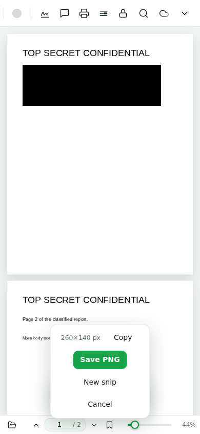

# 🍃 Leaf PDF

**A fast, privacy-first PDF viewer with a built-in Chrome extension** — redact, annotate, snip, protect, merge, split, sign and print PDFs, all in your browser. No uploads, no servers: every byte stays on your machine.



## Features

| Area | What you get |
|---|---|
| **View** | Smooth zoom, fit-width/fit-page, dark theme (Night / system theme), page search, thumbnail panel, outline (TOC) |
| **Links** | Internal document links (jump between pages) and external links (open in a new tab) are fully clickable |
| **Annotate** | Freehand pen, highlight, text notes, shapes — on a real editable layer, undo/redo |
| **Redact** | Draw boxes → permanently burn them out of the PDF (text is really gone, not just covered), or flatten whole pages to images |
| **Protect** | Encrypt/decrypt with passwords, owner/open permissions, AES-256 |
| **Snip** | One-click screenshot tool in the toolbar (outside the ⋯ menu) — rectangle snips of any region, saved as PNG |
| **Print** | The toolbar Print button goes **straight to your browser's print dialog** — no extra dialogs (Chromium browsers) |
| **Files** | Merge several PDFs, split by ranges, sign by drawing/pasting, download annotated or flattened copies |
| **Cloud** | Optional Google Drive open/save behind a toggle; local files never leave the device |
| **Offline** | Works with **zero network** — all libraries are bundled in `lib/` (CDN is only a fallback) |
| **Extension** | Chrome/Chromium extension that replaces the built-in PDF viewer and intercepts PDF URLs, content-type redirects and clicks |

## Project structure

The app is split into separate files — no more single-file build:

```
index.html          entry point (markup + script tags, no inline JS)
css/style.css       all styles
js/libs.js          library loading: local copies first, CDN fallback
js/boot.js          globals, DOM helpers, file open pipeline
js/render.js        page rendering, search, internal/external links
js/annotate.js      annotation engine (pen, highlight, text, shapes)
js/print-save.js    print pipeline (direct browser print) + downloads
js/ui.js            toolbar wiring, outline, dialogs, theme, snip
js/files.js         merge & split
js/cloud.js         settings, sign-in, Google Drive open/save
js/tools.js         redact & flatten
js/app.js           boot sequence
lib/                pdf.js, pdf-lib, jszip (bundled, self-hosted)
icons/              logo & favicon (SVG, extracted from the app's own mark)
extension/          Chrome MV3 extension (replaces the built-in PDF viewer)
docs/screenshots/   feature screenshots
```

## Run locally

Any static file server works:

```bash
cd leaf-pdf
python3 -m http.server 8080
# open http://localhost:8080/index.html
```

Or just open `index.html` from disk — local `lib/` copies load first, so it works offline.

## Chrome extension

```bash
# Chrome → chrome://extensions → Developer mode → Load unpacked
# select the `extension/` folder
```

The extension redirects `*.pdf` URLs, `Content-Type: application/pdf` responses and in-page PDF clicks to its own viewer (`index.html?src=<original url>`), and keeps everything extension-local for MV3 CSP compliance. The manifest icon is the same mark the app itself uses in its toolbar.

## Tests

Automated suites (Playwright) cover: render, redact/flatten, protect, snip, print, **internal + external links**, `?src=` deep links, offline (network blocked), save modes (copy / boxes-only / flatten), mobile layout, dark theme, zero console errors, and the extension flow (URL redirect, content-type redirect, CSP-safe worker, redaction inside the extension).

## Privacy

- Local files are parsed in-memory and never uploaded.
- Cloud features are opt-in and clearly marked; local-first is the default.
